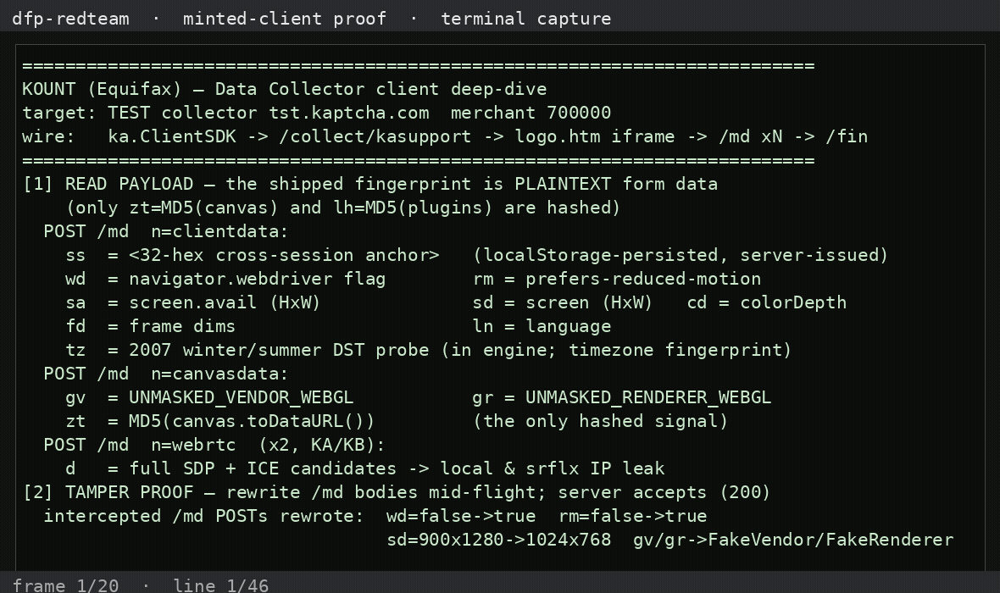

# dfp-redteam-kount — Kount (Equifax) Data Collector

Authorized red-team on Kount's **TEST** collector (`tst.kaptcha.com`, merchant
`700000`) — public sandbox, no customer/prod traffic touched. Full detail:
[`KOUNT_BREAK_2026_11_02.md`](KOUNT_BREAK_2026_11_02.md).

---

## What we proved

Kount ships device collection in **three pieces**: a 6 KB `ka.ClientSDK`
(loaded from `/collect/sdk?m=<merchant>`), a 2.2 KB server-config script
(`/collect/kasupport`) that carries the server-issued **FPCV** device cookie,
and a **24.5 KB collector engine** delivered inside a hidden `/logo.htm`
iframe. The engine runs 5 modules and POSTs the fingerprint to `/md`:

- `n=clientdata` — screen dims/color depth, `wd` (webdriver flag), `rm`
  (reduced motion), language, the 2007 winter/summer DST timezone probe, and
  the **cross-session `ss` anchor** (32-hex, localStorage-persisted)
- `n=canvasdata` — `gv`/`gr` (**unmasked** WebGL vendor/renderer) + `zt`
  (MD5 of the canvas render)
- `n=webrtc` ×2 — full SDP + ICE candidates → **local + srflx IP leak**
- `/fin` — `n=collect-end&com=true` completion marker

**The wire is plaintext form data.** No encryption, no signature — only two
MD5 hashes (`zt`, `lh`) and the server-issued opaque values (FPCV cookie,
`ss` anchor) are non-readable, and those are identity *tokens*, not secrets.

## Status

- 🟢 Read payload: **full plaintext** — `/md` clientdata/canvasdata/webrtc
  decoded; engine (24.5 KB) + SDK + config script fully readable
- 🟢 Tamper with payload: rewrite `/md` bodies mid-flight
  (webdriver/reduced-motion/screen/GL flipped) → **accepted (200)**
- 🟢 Mint token: forge the cross-session `ss` anchor (32-hex, client-persisted,
  no server cross-check) → shipped verbatim + **200**; stolen
  (ss + FPCV) pair replays cleanly — server holds the replayed identity
- 🟢 No linkage: an **FPCV from device A + an `ss` from device B** (mismatch)
  is accepted (all 200) — the collector does **not** tie the two identities
  together at collection time (`scripts/knt-crosscheck.mjs`)
- 🔴 Forge FPCV: the device cookie **is** server-validated (garbage → 400) —
  the server-side FPCV validation + RIS graph is the real moat

## Recorded demo

<video src="assets/demo-kount.mp4" width="720" controls></video>

## Artifacts (hyperlinked)

- [`artifacts/logo.htm.collector-engine`](artifacts/logo.htm.collector-engine) — the 24.5 KB collector engine (5 modules, MD5, timezone probe)
- [`artifacts/collect-sdk.ka.ClientSDK.js`](artifacts/collect-sdk.ka.ClientSDK.js) — the 6 KB hosted SDK
- [`artifacts/kasupport.config-script.js`](artifacts/kasupport.config-script.js) — the server-config script (FPCV issue/echo/validate logic)
- [`artifacts/capture-requests.json`](artifacts/capture-requests.json) — full request flow (sdk → kasupport → logo.htm → /md×4 → fin)
- [`artifacts/tamper-log.json`](artifacts/tamper-log.json) — tampered /md bodies + 200s
- [`artifacts/mint-result.json`](artifacts/mint-result.json) — forged `ss=c0ffee…` shipped + accepted
- [`artifacts/spoof-result.json`](artifacts/spoof-result.json) / [`spoof3-evidence-trail.txt`](artifacts/spoof3-evidence-trail.txt) — stolen (ss + FPCV) replay, all 200, FPCV held
- [`artifacts/reject-result.json`](artifacts/reject-result.json) — garbage FPCV → `/collect/cookiestore` **400**

## Scripts (`scripts/`)

- `knt-capture.mjs` — drive the real SDK against TEST; dump the full flow
- `knt-tamper.mjs` — rewrite `/md` bodies mid-flight (tamper proof)
- `knt-mint.mjs` — forge `ss` (mint) / replay stolen pair (spoof) / garbage-FPCV (reject)
- `knt-spoof3.mjs` — instrumented replay showing exactly what the server saw
- `demo-kount.py` — print the full analysis (used for the recorded demo)

> Hosts are pinned via `--host-resolver-rules` (sandbox DNS can't resolve
> `kaptcha.com`); collector ELB IPs from DNS-over-HTTPS.

## Honest caveats

- Assessed against Kount's **TEST** collector with the public demo merchant
  (`700000`); we observed accepted/tamperable collection but **did not assess
  the RIS scoring/decision layer** (no merchant RIS credentials).
- The FPCV device cookie is **server-validated** (garbage rejected, 400) —
  we can replay a stolen pair and mint the `ss` anchor, but cannot forge an
  arbitrary valid FPCV. The moat is server-side, as with the other
  server-graph vendors.

## Live deployments (2026-11-02)

Real merchant deployments found via public urlscan.io search + page fetches —
see [`LIVE_DEPLOYMENTS_2026_11_02.md`](LIVE_DEPLOYMENTS_2026_11_02.md).
